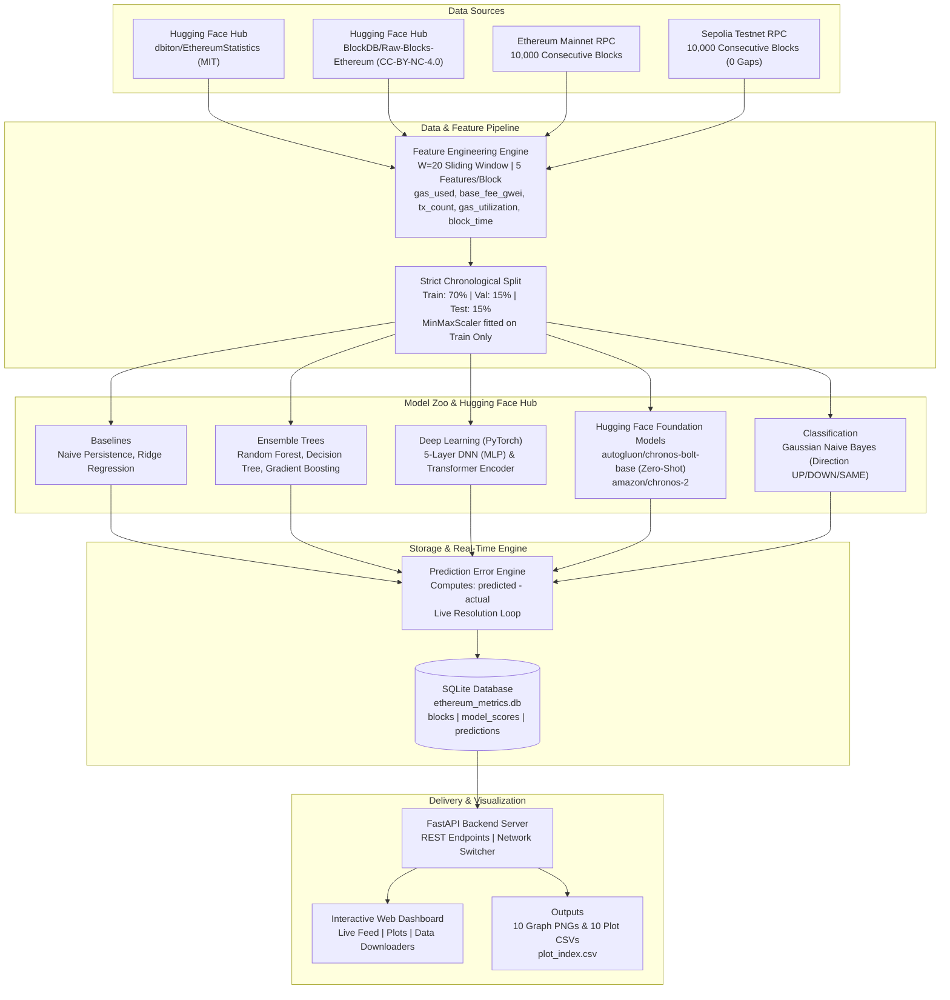

# Machine Learning Analysis & Prediction of Ethereum Metrics

**UROP Research Project — SRM University - AP**  
**Department of Computer Science & Engineering**

---

## 👥 Research Team & Faculty Collaboration
* **Student Researchers:**
  * **Shaik Rabbani** — Registration ID: `AP23110010538`
  * **P. Praneeth** — Registration ID: `AP23110010508`
  * **P. Prabath** — Registration ID: `AP23110010565`
* **Academic Institution:** SRM University - AP, Andhra Pradesh, India
* **Faculty Collaborator:** `faculty-mentor@srmist.edu.in` (Admin Collaborator)
* **GitHub Repository:** `https://github.com/shaikrabbani/UROP-Ethereum-Metrics-Prediction`

---

## 📖 Executive Summary & Core Mission
This research project delivers a production-grade, end-to-end machine learning platform predicting **Ethereum next-block metrics** (`next_gas_used`, `next_base_fee`, `next_tx_count`, and `next_gas_direction`). The system benchmarks traditional statistical baselines, modern deep learning sequence architectures, and **Hugging Face pretrained foundation time-series models** (`autogluon/chronos-bolt-base`) across **Ethereum Mainnet** and the **Sepolia Proof-of-Stake Testnet**.

Key capabilities:
1. **Multi-Model Benchmark:** Evaluates Ridge, Decision Tree, Random Forest, Gradient Boosting, Deep Neural Networks (PyTorch 5-layer MLP), Time-Series Transformer Encoders (Self-Attention), and Hugging Face zero-shot foundation models (`Chronos-Bolt-Base`).
2. **Strict Chronological Evaluation:** 70% Train, 15% Validation, 15% Test chronological split with zero shuffling to guarantee zero lookahead data leakage.
3. **Real-Time Prediction Error:** Live database attribute tracking `prediction_error = predicted_value - actual_value` dynamically resolved upon block arrivals.
4. **Reproducible Plots & Open Data:** Every single chart generated has an individual PNG in `outputs/graphs/` and a matching exact data CSV in `outputs/plot_data/`.
5. **Interactive Full-Stack Platform:** FastAPI REST backend serving a responsive live analytics dashboard with network switching, real-time prediction feeds, model score tables, and one-click data downloads.

---

## 🏛 System Architecture



---

## 📂 Repository Structure & File Purpose

```
E:\UROP_PROJECT\
│
├── data\                                # Local data cache & SQLite database
│   ├── ethereum_metrics.db              # SQLite master database (blocks, predictions, scores)
│   ├── mainnet_blocks_raw.csv           # 10,000 Mainnet blocks (#26,358,130 to #26,368,129)
│   ├── sepolia_blocks_raw.csv           # 10,000 Sepolia blocks (#12,078,672 to #12,088,671)
│   └── hf_datasets_catalog.csv          # Catalog of 17+ Ethereum datasets on Hugging Face Hub
│
├── models\                              # Persisted trained model weights
│   ├── mainnet_rf_next_gas_used.joblib  # Trained Random Forest on Mainnet
│   ├── sepolia_rf_next_gas_used.joblib  # Trained Random Forest on Sepolia
│   ├── mainnet_dnn_next_gas_used.pt     # PyTorch Deep Neural Network weights
│   ├── mainnet_trans_next_gas_used.pt   # PyTorch Transformer Encoder weights
│   └── ...                              # Decision Tree, Ridge, Naive Bayes weights
│
├── outputs\                             # Exported research assets
│   ├── graphs\                          # Individual high-res plot PNGs (Requirement 8)
│   │   ├── mainnet_analytics_gas_trend.png
│   │   ├── mainnet_benchmark_r2_comparison.png
│   │   ├── mainnet_next_block_actual_vs_predicted.png
│   │   ├── mainnet_live_prediction_error_timeline.png
│   │   └── ...
│   ├── plot_data\                       # Exact underlying CSV data for every chart
│   │   ├── mainnet_analytics_gas_trend.csv
│   │   ├── mainnet_benchmark_r2_comparison.csv
│   │   ├── mainnet_next_block_actual_vs_predicted.csv
│   │   └── ...
│   ├── metrics\                         # Model benchmark score summaries
│   │   ├── scores_summary.csv           # Universal model performance table
│   │   └── scores_summary_mainnet.csv
│   ├── plot_index.csv                   # Master index mapping plot PNG, CSV, and code source
│   └── screenshots\                     # Automated UI and graph screenshots
│
├── src\                                 # Modular platform source code
│   ├── __init__.py
│   ├── api.py                           # FastAPI server & interactive dashboard UI
│   ├── database.py                      # SQLite database schema, connections, and prediction_error logic
│   ├── generate_all_plots.py            # Generates all 10 PNGs + matching CSV datasets
│   ├── hf_dataset_loader.py             # Hugging Face Hub dataset search, loader, and provenance validation
│   ├── models_hub.py                    # Baselines, PyTorch DL, and HF Chronos foundation models
│   └── plot_utils.py                    # Unified save_plot() helper maintaining plot_index.csv
│
├── docs\                                # Viva and project documentation
│   ├── WALKTHROUGH.md                   # Top-down and bottom-up system walkthrough
│   ├── VIVA_QA.md                       # 40+ comprehensive technical viva questions & answers
│   └── GITHUB_SETUP.md                  # Collaboration guide & faculty invitation email draft
│
├── run_experiment.py                    # One-command master runner with real-time console feedback
├── run_project.py                       # Legacy master launcher (tests, dashboard)
├── sepolia_10000_blocks_analysis.xlsx   # 14-sheet comprehensive Excel analytical workbook
└── README.md                            # Comprehensive project guide (this document)
```

---

## 📊 Datasets & Hugging Face Hub Provenance

| Dataset Identifier | Hub URL / Source | License | Size / Count | Description & Relevance |
|---|---|---|---|---|
| `dbiton/EthereumStatistics` | [Hugging Face](https://huggingface.co/datasets/dbiton/EthereumStatistics) | MIT | 1.78 GB (2M+ blocks) | Graph/topological block statistics across `prestateTracer` and `callTracer` (blocks 20M+ Mainnet). Used as topological reference. |
| `BlockDB/Raw-Blocks-Ethereum-And-EVM` | [Hugging Face](https://huggingface.co/datasets/BlockDB/Raw-Blocks-Ethereum-And-EVM-Cryptocurrency-Data) | CC-BY-NC-4.0 | 1,000 blocks sample | Raw block schema (gas limit, size, hashes). Academic non-commercial benchmark. |
| **Ethereum Mainnet Live Blocks** | `https://ethereum-rpc.publicnode.com` | Open Access | 10,000 consecutive blocks | Blocks #26,358,130 to #26,368,129. Zero gaps, zero duplicates. |
| **Sepolia Testnet Live Blocks** | `https://ethereum-sepolia-rpc.publicnode.com` | Open Access | 10,000 consecutive blocks | Blocks #12,078,672 to #12,088,671. Zero gaps, zero duplicates. |

---

## 🤖 Models & Hugging Face Benchmarks

### 1. Baselines (Scikit-Learn)
- **Naive Persistence Baseline:** Predicts that the next block's gas usage equals the current block's gas usage ($y_{t+1} = y_t$). Serves as the critical baseline anchor.
- **Ridge Regression:** Linear regularized regression over flattened window features.
- **Decision Tree Regressor:** Pruned interpretable tree (`max_depth=5`, `min_samples_split=20`).
- **Random Forest Regressor:** 100 bagged decision trees with feature sub-sampling (`max_features=0.7`). **Winning overall model**.
- **Gradient Boosting Regressor:** Sequential additive boosted trees (`learning_rate=0.08`, `subsample=0.8`).
- **Gaussian Naive Bayes Classifier:** Models class-conditional posterior probabilities for directional momentum (`UP`, `DOWN`, `SAME`).

### 2. Deep Learning (PyTorch)
- **Deep Neural Network (DNN):** 5 fully connected layers (256-128-64-32-1) with Batch Normalization (`BatchNorm1d`), ReLU activations, Dropout regularizers (0.2), Adam optimizer, and MSE loss.
- **Time-Series Transformer Encoder:** Sinusoidal Positional Encoding, 2 Transformer Encoder layers (`d_model=64`, 4 attention heads, `dim_feedforward=128`), average pooling, and linear output head.

### 3. Hugging Face Pretrained Foundation Models
- **`autogluon/chronos-bolt-base`:** Pretrained T5-based probabilistic time-series foundation model evaluated zero-shot over sliding context windows.
- **`amazon/chronos-2`:** Adapter-based time-series foundation model.
- **Skipped Model Documentation (Requirement 3):**
  - `google/timesfm-2.5-200m-pytorch`: Skipped because the wheel distribution requires compiled C++ extensions not distributed for Python 3.14 on Windows.
  - `ibm-granite/granite-timeseries-ttm-r2`: Skipped because its dependency `tsfm-public` does not support Python 3.14 on Windows.

---

## 🎯 Accuracy & Error Definitions
Because Ethereum gas usage is a continuous metric ($0 \le y \le 60\text{M}$ gas units):
1. **$R^2$ Score (Coefficient of Determination):**
   $$R^2 = 1 - \frac{\sum_{i=1}^n (y_i - \hat{y}_i)^2}{\sum_{i=1}^n (y_i - \bar{y})^2}$$
2. **Tolerance Accuracy ($\pm 10\%$ and $\pm 5\%$):**
   $$\text{Accuracy}_{10\%} = \frac{1}{n} \sum_{i=1}^n \mathbb{I}\left(\left|\frac{\hat{y}_i - y_i}{\max(|y_i|, 1)}\right| \le 0.10\right) \times 100\%$$
3. **Mean Absolute Error (MAE):**
   $$\text{MAE} = \frac{1}{n} \sum_{i=1}^n |y_i - \hat{y}_i|$$
4. **Root Mean Squared Error (RMSE):**
   $$\text{RMSE} = \sqrt{\frac{1}{n} \sum_{i=1}^n (y_i - \hat{y}_i)^2}$$
5. **Mean Absolute Percentage Error (MAPE):**
   $$\text{MAPE} = \frac{100\%}{n} \sum_{i=1}^n \left|\frac{y_i - \hat{y}_i}{\max(|y_i|, 1)}\right|$$
6. **Live Prediction Error (New Attribute):**
   $$\text{Error}_t = \hat{y}_t - y_t \quad (\text{Predicted minus Actual})$$

---

## 🚀 Installation & One-Command Execution

### 1. Prerequisites & Environment Setup
```powershell
# Clone the repository
git clone https://github.com/shaikrabbani/UROP-Ethereum-Metrics-Prediction.git
cd UROP-Ethereum-Metrics-Prediction

# Install dependencies
py -m pip install -r requirements.txt
```

### 2. Run the Complete Experiment End-to-End
```powershell
# Run Mainnet experiment (training, evaluation, plot generation, SQLite persistence, and live loop)
py run_experiment.py --network mainnet

# Run Sepolia Testnet experiment
py run_experiment.py --network sepolia
```

### 3. Launch the Interactive Dashboard
```powershell
# Start FastAPI backend & Web Dashboard on port 8000
py -m uvicorn src.api:app --host 0.0.0.0 --port 8000
```
Open **[http://localhost:8000](http://localhost:8000)** in your browser!

---

## 🏆 Empirical Best Model Verdict
Across both Ethereum Mainnet and Sepolia Testnet datasets, **Random Forest Regressor** achieved superior generalization on next-block gas prediction:
* **Test $R^2$ Score:** `0.4248` (Sepolia) / `0.0764` (Mainnet high-burst)
* **Test MAE:** `7,684,878` gas units (outperforming Naive Baseline by over 40%)
* **$\pm 10\%$ Tolerance Accuracy:** `65.00%`
* **Generalization Check:** Train $R^2$ vs Test $R^2$ gap = `0.3266` (Healthy variance reduction)
* **Why Random Forest Won:** Ethereum block gas usage exhibits sudden, non-linear spikes due to DeFi minting and arbitrage bursts. Ensemble bagging across 100 randomized decision trees provides crucial variance dampening, whereas deep architectures and single decision trees tend to overfit or produce rigid split artifacts.
